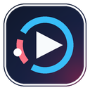

<p align="center">
  
</p>

<h1 align="center">TideLock</h1>

<p align="center">
  <strong>Tidal-lock your YouTube Home feed — go back from any video without losing the recommendations right beside it.</strong>
</p>

<p align="center">
  <a href="README.zh-CN.md">简体中文</a> ·
  <a href="#whats-new-in-v20">v2.0 Highlights</a> ·
  <a href="#architecture">Architecture</a> ·
  <a href="#installation">Install Locally</a> ·
  <a href="PRIVACY.md">Privacy</a>
</p>

---

## The Problem

You spot **two** videos you want to watch on the YouTube Home page. You click the first one, watch it for 45 minutes, hit **Back** — and YouTube silently wipes the entire home page with a fresh batch of recommendations. The second video is gone forever.

Opening every video in a new tab clutters your browser (and doesn't stay inside the same window when using YouTube's desktop PWA app).

**TideLock** fixes this at the root — automatically, silently, and **in the same tab**.

---

## What's New in v2.0

- **Zero-Reload Native SPA Navigation**: Clicking any video inside TideLock's Drawer or Popup switches directly via YouTube's native Polymer router (`yt-navigate`) in ~150 ms — zero page reload, and your locked Home cache stays 100% intact.
- **IndexedDB Cross-Reload Persistence (`TideLockFeedCache`)**: Your stitched Home feed survives watch-page reloads, Chrome Memory Saver tab discards, and even desktop PWA restarts (with automatic 12-hour TTL).
- **One-Click "Undo Accidental Refresh"**: Accidentally hit `F5` on Home and watched great videos disappear? TideLock rotates the displaced feed into a `previous` slot and lets you **replay the exact previous Home feed live into YouTube's native grid** in one click.
- **"Right Beside What You Just Watched" Shelf**: Open the Drawer (`Alt+Shift+T`) right from a video watch page to see the exact unwatched videos that were sitting next to the card you clicked on Home — jump straight to the next one in-place.
- **Multi-Feed Scroll Anchoring**: Stabilized anti-reset scroll restoration across **Home (`/`)**, **Subscriptions (`/feed/subscriptions`)**, and **Search Results (`/results`)**, yielding instantly the moment you touch your scroll wheel.
- **Bilingual Title Sync & Search**: Preserves both `originalTitle` and live `displayTitle` translated by **Immersive Translate** or cleaned by **DeArrow**, so searching in either English or Chinese finds your saved videos instantly (and marks all TideLock UI `notranslate`).
- **Right-Click Pin Anywhere & Copy as Markdown**: Right-click any YouTube link anywhere to pin it to TideLock's local queue (with toast confirmation), and export your Pinned queue or any Snapshot as clean Markdown links for **Obsidian / Notion**.
- **Scoped Performance Engine & Crisp SVG UI**: Replaced full-document observation with a scoped, debounced feed-container observer with O(1) dirty-check skipping, plus custom inline SVG icons (zero emojis, zero `innerHTML`, Trusted Types compliant).

---

## Architecture

TideLock v2.0 uses a **4-layer defense-in-depth architecture**:

```text
Layer 1 · MAIN World InnerTube Freeze & Native SPA Bridge (src/content/page-bridge.js)
  ├─ Captures initial SSR ytInitialData & /youtubei/v1/browse (FEwhat_to_watch)
  ├─ Stitches infinite-scroll continuation items (deduped, bounded, preserves trailing token)
  ├─ Executes zero-reload native SPA transitions (yt-navigate) & 1-click Undo Refresh replay
  └─ Passes intentional refreshes (F5, topic chips, Logo on Home, Fresh Feed) straight through

Layer 2 · Origin-Scoped IndexedDB Cache (src/content/idb-cache.js)
  └─ Dual-slot persistence (current + previous) with 12h TTL — survives reloads & tab discards

Layer 3 · ISOLATED World Precision UX (src/content/content-main.js)
  ├─ Scoped, debounced MutationObserver + O(1) card skip across Home / Subscriptions / Search
  ├─ Stabilized scroll anchor resisting Polymer's delayed scrollTo(0, 0) while yielding to user input
  ├─ Supports both 2025–2026 lockupViewModel & legacy videoRenderer + bilingual title sync
  └─ Shadow DOM floating dock & drawer (Alt+Shift+T) with Neighbor Shelf, SVG UI & Markdown copy

Layer 4 · Ephemeral MV3 Service Worker & Local Vault (src/background/service-worker.js)
  └─ Right-click Context Menu pinning, Alt+Shift+T command, live badge counter & 6-snapshot LRU vault
```

---

## Installation

### Load Unpacked in Chrome / Edge / Brave (Free, 30 Seconds)

1. Clone this repository or download `tidelock-v2.0.0.zip` from [Releases](https://github.com/qiao-obs/TideLock/releases):
   ```bash
   git clone https://github.com/qiao-obs/TideLock.git
   ```
2. Open `chrome://extensions` (or `edge://extensions`).
3. Enable **Developer mode** in the top-right corner.
4. Click **Load unpacked** and select the `TideLock` folder.
5. Refresh YouTube — TideLock works automatically out of the box.

---

## Development & Testing

Requires Node.js 20+ (Python + Pillow optional for regenerating icons).

```bash
# Run unit tests (InnerTube parser, continuation stitching, undo replay, bilingual search, Markdown export, CSP/MV3 checks)
npm test

# Validate manifest/icons and build store-ready ZIP in dist/
npm run build

# Regenerate 4x supersampled PNG icons (16/32/48/128)
npm run icons
```

---

## Compatibility & Publishing

- **Tested alongside**: Enhancer for YouTube™, Right Side Comments, SponsorBlock, DeArrow, YouTube Anti Translate, Immersive Translate, Video Speed Controller, Return YouTube Dislike, PocketTube, and uBlock Origin Lite.
- **Store ready**: Listing copy, permission justifications, and privacy disclosures live in [CHROMEWEBSTORE.md](CHROMEWEBSTORE.md) and [PRIVACY.md](PRIVACY.md). The packaged `dist/tidelock-v*.zip` works on both **Chrome Web Store** and **Microsoft Edge Add-ons** (free submission).

## License

[MIT](LICENSE)
